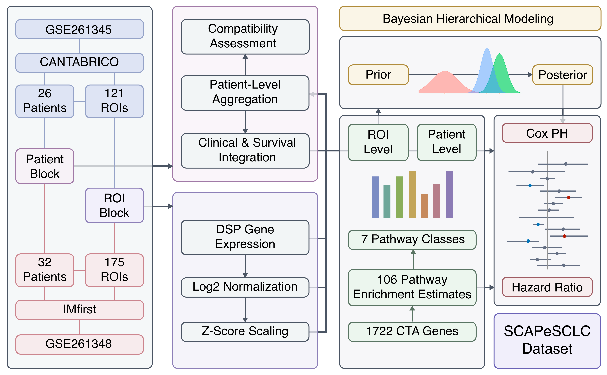
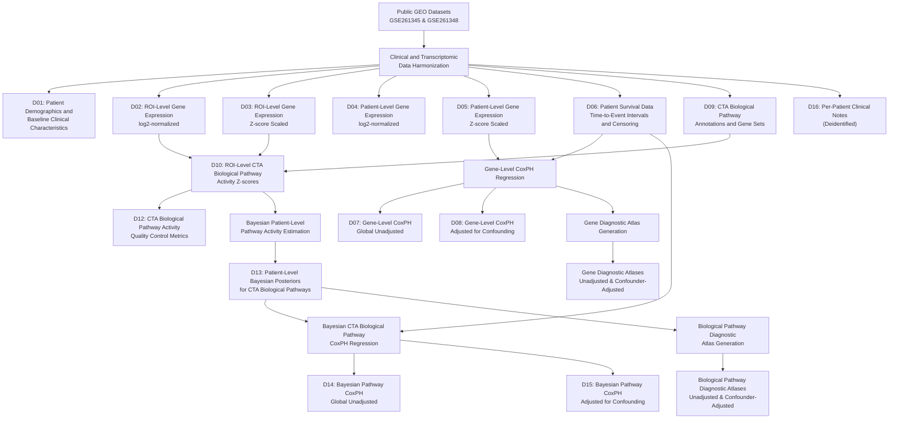

# SCAPeSCLC

**SCAPeSCLC** is a harmonized multi-level transcriptomic and clinical resource derived from the publicly available GEO datasets **GSE261345** and **GSE261348**, originating from the CANTABRICO and IMfirst cohorts of patients with extensive-stage small cell lung cancer (ES-SCLC).



This repository contains the R scripts and supporting datasets used to generate Bayesian pathway posterior estimates, perform gene- and pathway-level survival analyses, assess Cox proportional hazards model assumptions, and generate comprehensive diagnostic atlases for both gene expression and biological pathway activity.

The repository accompanies **SCAPeSCLC v1.4.0**, the published dataset and associated data paper.

---

## Current Release (v1.4.0)

**New in v1.4.0:**

- EpiFactors-associated gene expression subsets at the ROI and patient levels, provided as log2-normalized and Z-score-scaled tables.
- An EpiFactors gene-mapping quality control table documenting the curated gene selection and its annotations.
- A companion Excel workbook containing the EpiFactors-associated data products.

**Previously available resources retained in this release:**

- Gene-level diagnostic atlases (unadjusted and confounder-adjusted)
- Biological pathway diagnostic atlases (unadjusted and confounder-adjusted)
- Proportional hazards assumption testing for all gene and pathway Cox models
- Bayesian estimation of patient-level Cancer Transcriptome Atlas pathway activities
- Complete SCAPeSCLC dataset provided in CSV and consolidated XLSX formats

The v1.4.0 EpiFactors additions extend the distributed data resources; the existing R analytical scripts are unchanged.

---

## Associated Resources

- **Zenodo dataset (archival repository):** https://doi.org/10.5281/zenodo.19897644
- **Data paper:**  
  Shirvaliloo M. SCAPeSCLC: An Integrated Spatial Transcriptomic and Bayesian Pathway Enrichment Dataset for Survival Modeling in Extensive-Stage Small Cell Lung Cancer. *Data*. 2026;11(7):152. https://doi.org/10.3390/data11070152

---

# Repository Structure

```text
SCAPeSCLC
├── data/
│   ├── D5_scaled_gene_expression.csv
│   ├── D10_ROI_CTA_Zscores.csv
│   └── D13_patient_BP_posteriors.csv
│
├── dataset/
│   ├── csv/
│   │   ├── D01_patient_demographics_and_baseline_clinical_characteristics.csv
│   │   ├── D02_ROI_level_gene_expression_log2_normalized.csv
│   │   ├── D02Epi_ROI_level_EpiFactors_associated_gene_expression_log2_normalized.csv
│   │   ├── D03_ROI_level_gene_expression_Z_scores_scaled.csv
│   │   ├── D03Epi_ROI_level_EpiFactors_associated_gene_expression_Z_scores_scaled.csv
│   │   ├── D04_patient_level_gene_expression_log2_normalized.csv
│   │   ├── D04Epi_patient_level_EpiFactors_associated_gene_expression_log2_normalized.csv
│   │   ├── D05_patient_level_gene_expression_Z_scores_scaled.csv
│   │   ├── D05Epi_patient_level_EpiFactors_associated_gene_expression_Z_scores_scaled.csv
│   │   ├── D06_patient_survival_data_time_to_event_intervals_and_censoring.csv
│   │   ├── D07_gene_level_CoxPH_global_unadjusted.csv
│   │   ├── D08_gene_level_CoxPH_adjusted_for_confounding.csv
│   │   ├── D09_CTA_biological_pathway_annotations_and_gene_sets.csv
│   │   ├── D10_ROI_level_CTA_biological_pathway_activity_Z_scores.csv
│   │   ├── D11_patient_level_CTA_biological_pathway_activity_Z_scores.csv
│   │   ├── D12_CTA_biological_pathway_activity_quality_control_metrics.csv
│   │   ├── D13_patient_level_Bayesian_posteriors_for_CTA_biological_pathways.csv
│   │   ├── D14_Bayesian_CTA_biological_pathways_CoxPH_global_unadjusted.csv
│   │   ├── D15_Bayesian_CTA_biological_pathways_CoxPH_adjusted_for_confounding.csv
│   │   ├── D16_per_patient_clinical_notes_deidentified.csv
│   │   └── D17_EpiFactors_gene_mapping_quality_control.csv
│   │
│   ├── SCAPeSCLC.xlsx
│   └── SCAPeSCLC_EpiFactors.xlsx
│
├── figures/
│   └── SCAPeSCLC_pipeline.png
│
└── scripts/
    ├── 01_gene_level_cox_models.R
    ├── 01_gene_level_cox_ph_assumptions.R
    ├── 02_bayesian_patient_level_pathways.R
    ├── 03_pathway_posterior_cox_models.R
    ├── 03_pathway_posterior_cox_ph_assumptions.R
    ├── 04_SCAPeSCLC_diagnostic_atlas_generator_for_genes.R
    ├── 04_SCAPeSCLC_diagnostic_atlas_generator_for_genes_confounder_adjusted.R
    ├── 05_SCAPeSCLC_diagnostic_atlas_generator_for_BPs.R
    └── 05_SCAPeSCLC_diagnostic_atlas_generator_for_BPs_confounder_adjusted.R
```

---

### Analysis Input Files

The `data/` directory contains the three analysis-ready data files directly used as inputs by the R scripts in this repository.

| File | Description |
| --- | --- |
| **D5_scaled_gene_expression.csv** | Patient-level standardized gene expression matrix. |
| **D10_ROI_CTA_Zscores.csv** | ROI-level Cancer Transcriptome Atlas pathway enrichment Z-scores. |
| **D13_patient_BP_posteriors.csv** | Patient-level Bayesian posterior pathway activity estimates. |

### Complete SCAPeSCLC Dataset

The `dataset/` directory contains the complete SCAPeSCLC v1.4.0 dataset in CSV and Excel formats:

- **CSV format:** The `dataset/csv/` directory contains 21 tables: the original D01–D16 tables, four EpiFactors-associated expression subsets (D02Epi–D05Epi), and the D17 EpiFactors gene-mapping quality control table.
- **Excel format:** `dataset/SCAPeSCLC.xlsx` contains the main SCAPeSCLC tables, while `dataset/SCAPeSCLC_EpiFactors.xlsx` is the companion workbook for the EpiFactors-associated data products.

### EpiFactors-Associated Data (v1.4.0)

The EpiFactors tables provide curated subsets of the existing gene expression matrices, restricted to EpiFactors-associated genes. They retain the original ROI- or patient-level organization and expression scaling. **D17** provides the corresponding gene-mapping and quality control information.

| File | Description |
| --- | --- |
| **D02Epi** | ROI-level EpiFactors-associated gene expression, log2-normalized; subset of D02. |
| **D03Epi** | ROI-level EpiFactors-associated gene expression, Z-score scaled; subset of D03. |
| **D04Epi** | Patient-level EpiFactors-associated gene expression, log2-normalized; subset of D04. |
| **D05Epi** | Patient-level EpiFactors-associated gene expression, Z-score scaled; subset of D05. |
| **D17** | Gene annotations and mapping quality control for the EpiFactors-associated selection. |
| **SCAPeSCLC_EpiFactors.xlsx** | Companion workbook collecting the EpiFactors-associated tables. |

These files expand the available expression data products; they do not represent an additional survival-modeling or Bayesian estimation workflow.

---

## Analysis Workflow

The repository implements the following analytical workflow:

1. Bayesian estimation of patient-level pathway activities from ROI-level Cancer Transcriptome Atlas pathway enrichment scores.
2. Gene-level Cox proportional hazards regression for progression-free, disease-specific, and overall survival.
3. Pathway-level Cox proportional hazards regression using Bayesian posterior pathway activity estimates.
4. Assessment of proportional hazards assumptions using Schoenfeld residuals for both gene- and pathway-level Cox regression models.
5. Generation of comprehensive diagnostic atlases for both genes and biological pathways, including:
   - model summary statistics,
   - hazard ratios and 95% confidence intervals,
   - Wald test statistics,
   - proportional hazards test results,
   - Martingale residuals,
   - Schoenfeld residuals,
   - Deviance residuals,
   - DFBETA influence diagnostics.
6. Generation of both unadjusted and confounder-adjusted diagnostic atlases for all survival endpoints (OS, DSS, and PFS).

---

## Data Provenance and Analytical Workflow

The diagram below summarizes the provenance of the major data products included in SCAPeSCLC and their relationships to the analytical pipelines implemented in this repository. The v1.4.0 EpiFactors-associated subsets are derived from D02–D05 and are described separately above; the diagram focuses on the core analytical workflow.



---

## Requirements

R **4.2** or later is recommended.

Required packages:

```r
install.packages(c(
  "dplyr",
  "survival",
  "broom",
  "purrr",
  "brms",
  "tidyr",
  "stringr",
  "ggplot2",
  "patchwork",
  "cowplot",
  "gtable"
))
```

---

## Citation

If you use **SCAPeSCLC** in your work, please cite the Zenodo dataset and the accompanying data paper. The GitHub repository provides the analysis code and an accessible copy of the complete dataset.

---

## License

This project is distributed under the **MIT License**.
